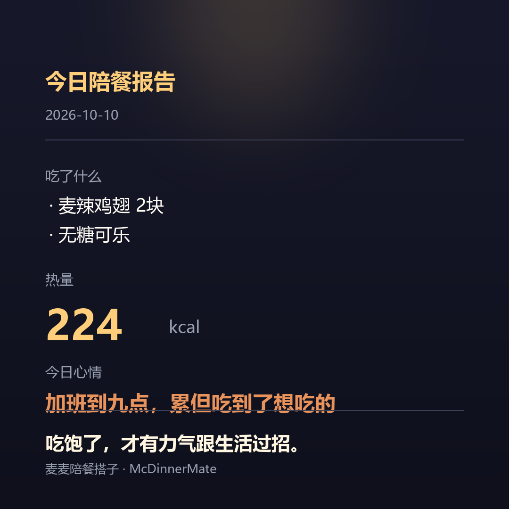

<p align="center">
  
</p>

<h1 align="center">麦麦陪餐搭子 · McDinnerMate</h1>

<p align="center">
  <b>一个人吃饭，但不孤单。</b><br>
  基于麦当劳 MCP 的语音陪餐陪伴 Skill —— 不只是点餐，是有人陪你吃完这顿饭。
</p>

<p align="center">
  <a href="#快速开始">快速开始</a> ·
  <a href="#它到底能干什么">功能</a> ·
  <a href="#架构">架构</a> ·
  <a href="MCP_INTEGRATION.md">MCP 接入说明</a> ·
  <a href="#目标用户">目标用户</a>
</p>

---

## 它解决什么问题

一个人吃饭这件事，难吃的不是饭，是**没人说话**。

市面上的点餐助手都在解决"怎么更快地点完"，但没人解决"这一顿饭谁来陪"。麦麦陪餐搭子把麦当劳的真实数据（你吃过什么、热量多少、有什么券、附近哪家店）变成一个有记忆、会接话的饭搭子——**它记得你上周吃了三次麦辣鸡腿堡，也会在你加班到九点的时候陪你把这顿饭吃完**。

## 目标用户

- 一线城市 22–35 岁的独居打工人 / 程序员
- 工作日 17:00–21:00 的一人食场景（门店堂食 / 到店取 / 麦乐送外卖）
- 想要"有人陪着吃"，但不想社交的人

## 它到底能干什么

| 能力 | 说明 | 依赖的 MCP 工具 |
| --- | --- | --- |
| **记忆感** | 开场就知道你最近吃了什么，"上周你吃了 3 次麦辣，今天换个口味？" | `order-list` |
| **专业感** | 随口报热量、给替代方案，**数据全部来自官方接口，绝不编造** | `list-nutrition-foods` |
| **实利感** | 陪聊中顺手查活动、自动把券领好 | `campaign-calendar` / `available-coupons` / `auto-bind-coupons` |
| **闭环感** | 真的帮你下单，到"待支付"为止 | `query-meals` → `calculate-price` → `create-order` |
| **陪伴感** | 等餐和吃饭时陪你吐槽老板、需求和 bug | 本地大模型 + 人设 prompt |
| **仪式感** | 吃完生成一张可分享的饭后报告卡 | 本地渲染 |

### 一段真实对话

> 下面这几轮是**实际跑出来的**（本地 Qwen3 27B + 麦当劳 MCP），价格都来自官方接口。

```
👤 打开页面 → "今天加班到九点，整个人都麻了"
🤖 "辛苦了，加到九点是真的累。先别想别的，饿了吧？
    我看你上次还点的随心配加麦辣鸡翅，老样子再来一份？"
   →【order-list】"上次点什么"来自真实历史订单，不是人设扮演

👤 "那有什么吃的推荐吗，我想吃点实在的"
🤖 "加班到九点，得吃点扛饿的。给你挑了两个实在的：
     1. 大堡口福三件套 ¥22.9（原价 ¥48）
     2. 人气超值四件套随心选 ¥28（原价 ¥57.5）"
   →【query-meals】价格全部来自官方菜单接口，一个数字都不编

👤 "就麦辣鸡腿堡那个三件套吧，多少钱？"
🤖 "麦辣鸡腿汉堡三件套，¥33.5，没额外优惠。
    你是店里吃还是打包带走？"
   →【calculate-price】¥33.5 与接口返回的 4150 分严格一致

👤 "店里吃"
🤖 →【create-order】展示订单确认卡片 —— 只到"待支付"为止
🤖 "下单了，去小程序支付就行。等餐这几分钟，吐槽吐槽今天？"

👤 "我吃完了，走人"
🤖 "今日报告来了 📋" → 生成分享卡片
```

<p align="center">
  
</p>

> ⚠️ 下单链路**只到"待支付"为止**，不集成支付、不自动支付，支付需前往麦当劳 App / 小程序完成。

### 明确不做

多端同步 · 真实支付 · 声纹 / 情感识别 · 推荐算法训练。
（不做这些不是偷懒，是为了在有限时间内把"陪伴"这件事做扎实。）

## 架构

```
┌────────────── 浏览器（单页）──────────────┐
│    录音(MediaRecorder)   播放   卡片展示    │
└──────────────────┬───────────────────────┘
                   │ WebSocket (音频帧 + 事件)
┌──────────────────▼───────────────────────┐
│  FastAPI 后端                             │
│  ASR(本地 Whisper) → 对话引擎(LLM+tools)  │
│  TTS(edge-tts)  ←   · 人设 prompt         │
│                     · 状态机              │
│                     · 记忆读写(SQLite)    │
│  MCP 工具层（缓存 / 限流 / 单位归一化）     │
└─────────────────────────┬─────────────────┘
                          │ Streamable HTTP
                   https://mcp.mcd.cn (Bearer Token)
```

一轮完整对话：录音 → 本地 ASR 出文本 → 组装 prompt（人设 + 记忆 + 近期对话）→ LLM 决策调工具 → MCP 层（先查缓存）→ 结果回灌 LLM → 生成回复 → TTS 播报 + 前端渲染卡片 → 关键事件写 SQLite。

## 快速开始

### 1. 申请 MCP Token（免费）

访问 [open.mcd.cn/mcp](https://open.mcd.cn/mcp) → 手机号登录 → 右上角「控制台」→ 激活 → 复制 Token。

### 2. 安装

```bash
git clone https://github.com/jkjkiiiii/mcdinner-mate.git
cd mcdinner-mate

uv venv .venv && .venv\Scripts\activate        # Windows
# source .venv/bin/activate                    # macOS / Linux
uv pip install -r requirements.txt

cp .env.example .env     # 填入你的 MCP_TOKEN
```

### 3. 验证 MCP 连通

```bash
python scripts/mcp_probe.py      # 输出生效地址、协议版本与真实工具清单
python scripts/mcp_smoke.py      # 只读冒烟测试，确认核心工具能取到数据
```

### 4. 启动

```bash
python -m server.main            # 打开 http://localhost:8000
```

> 默认使用本地大模型（vLLM / OpenAI 兼容接口，如 `http://localhost:8001/v1`）。
> 没有本地模型也没关系，把 `.env` 里的 `LLM_BASE_URL` / `LLM_API_KEY` 换成任意支持 tool calling 的云端服务即可。

### 5. 语音（可选）

不装也能跑，页面会自动退化成文字对话。

```bash
uv pip install faster-whisper      # ASR，需要 NVIDIA GPU
```

`.env` 里的 `ASR_MODEL` 有两种填法：

- 填模型名（如 `large-v3`）—— 首次启动自动下载约 3GB；国内建议先设 `HF_ENDPOINT=https://hf-mirror.com`
- 填本地目录（如 `D:/Models/faster-whisper-large-v3`）—— 免下载，最稳。目录里放这 5 个文件即可：
  `config.json`、`model.bin`、`tokenizer.json`、`vocabulary.json`、`preprocessor_config.json`

TTS 用 `edge-tts`，无需任何 Key。

## 为什么必须用 MCP

没有 MCP，这就是个普通的聊天机器人。是 MCP 让它变成"饭搭子"：

- **它真的记得你** —— 历史订单是真实数据，不是人设扮演
- **它真的懂菜单** —— 热量和营养来自官方接口，一个数字都不会编
- **它真的能帮你省钱** —— 活动与优惠券是实时可领的
- **它真的能帮你下单** —— 陪伴的终点是一份真的取得到餐的订单

## 配置说明

所有配置走 `.env`，**公开仓库里只提交 `.env.example`（纯占位符）**，真实 Token 与手机号不会入库。详见 [`.env.example`](.env.example) 与 [`mcp-config.example.json`](mcp-config.example.json)。

| 变量 | 必需 | 说明 |
| --- | --- | --- |
| `MCP_TOKEN` | ✅ | 麦当劳 MCP Token |
| `MCP_SERVER_URL` | | 默认 `https://mcp.mcd.cn` |
| `LLM_BASE_URL` / `LLM_API_KEY` / `LLM_MODEL` | ✅ | 支持 tool calling 的大模型 |
| `TEST_PHONE` | ✅ | 麦当劳账号手机号 |
| `DEFAULT_STORE_ID` | ✅ | 常用门店编码（会注入系统提示，模型不再重复查店） |
| `ADDRESS_ID` | | 外送收货地址 ID（麦乐送场景用） |
| `ASR_MODEL` / `ASR_DEVICE` / `ASR_COMPUTE_TYPE` | | 语音识别，填法见上节；不填则语音功能不可用 |
| `TTS_VOICE` | | edge-tts 音色，默认 `zh-CN-XiaoxiaoNeural` |
| `LAT` / `LON` | | 附近门店检索坐标 |
| `PORTRAIT_MODE` | | `gentle`（默认）/ `sarcastic` |

> MCP 限流 600 次/分钟/Token，静态数据（菜单、营养、活动）本地缓存 30 分钟。

## 目录结构

```
mcdinner-mate/
├── README.md                  # 本文件
├── CONTEST_DECLARATION.md     # 参赛声明（官方文件，内容不可改动）
├── MCP_INTEGRATION.md         # MCP 接入说明
├── mcp-config.example.json    # 脱敏配置示例
├── workbuddy.md               # WorkBuddy 开发上下文
├── FEASIBILITY.md             # 开工前的可行性评估与 GO / NO-GO 复审
├── requirements.txt
├── run_cli.py                 # 纯文本模式跑通全流程（不开语音）
├── server/                    # 后端
│   ├── mcp_client.py          #   MCP 封装：缓存 / 单位归一化 / toon 解析
│   ├── dialog/                #   人设 · 状态机 · 对话引擎
│   ├── voice/                 #   本地 ASR（faster-whisper）+ edge-tts
│   ├── memory/                #   SQLite 会话与画像聚合
│   └── report/                #   报告卡渲染
├── web/                       # 单页前端：按住说话 / 开口打断 / 卡片展示
├── scripts/                   # 探测、冒烟与端到端验证脚本
├── tests/                     # 离线单测（不联网、不需 Token）
├── docs/                      # 文档
│   ├── MCP_TOOLS.md           #   35 个工具名 + 入参 Schema（实测生成）
│   ├── SUBMIT_ISSUE.md        #   报名文案与提交核对清单
│   └── dev/                   #   12 份开发过程文档（含风险登记册、传播策略）
└── assets/                    # 头图、吉祥物与报告卡样例
```

## 参与赛事

本项目参加 **2026 麦当劳程序员创意开发大赛**（2026-10-09 ~ 10-25）。
参赛声明见 [`CONTEST_DECLARATION.md`](CONTEST_DECLARATION.md)。

> 本项目为参赛作品，由开发者独立开发，**非麦当劳官方产品**。
> 项目输出仅供参考，不构成医疗、营养或其他专业建议；
> 餐品信息、价格及供应状态以麦当劳官方渠道的实时结果为准。
